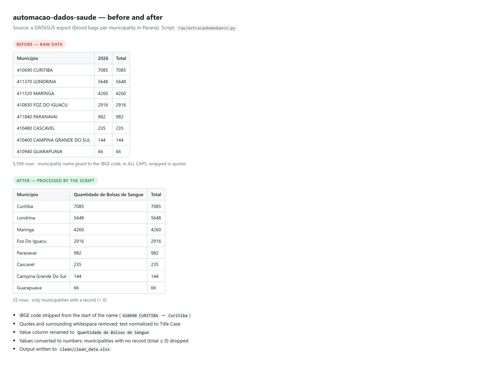

# Automação Dados Saúde - DATASUS

[English](README.md) · Português

Script em Python e pandas que limpa e padroniza uma exportação do DATASUS com o número
de bolsas de sangue por município do Paraná, gerando uma planilha pronta para análise.

## O problema

A exportação do DATASUS junta o nome do município ao código do IBGE
(`410690 CURITIBA`), coloca tudo entre aspas, usa caixa alta e inclui linhas sem valor.
Nesse formato, o dado não pode ser cruzado com outras bases nem apresentado diretamente.

## O que o script faz

**Entrada:** `raw/municipio.csv` (separado por ponto e vírgula)

1. Remove o código numérico do IBGE do início do nome do município
2. Remove aspas e espaços nas pontas
3. Padroniza o texto com iniciais maiúsculas (`Foz Do Iguacu`)
4. Renomeia a coluna de valor para `Quantidade de Bolsas de Sangue`
5. Converte os valores para número e descarta municípios sem registro (total <= 0)

**Saída:** `clean/clean_data.xlsx`



## Tecnologias

- Python 3
- pandas
- openpyxl (escrita de `.xlsx`)

## Estrutura

```
.
├── raw/
│   ├── extracaohemobanco.py   # script de limpeza
│   └── municipio.csv          # dado bruto do DATASUS
└── clean/
    └── clean_data.xlsx        # resultado
```

## Como executar

```bash
pip install pandas openpyxl
python raw/extracaohemobanco.py
```

Os caminhos são resolvidos a partir do próprio script, então ele roda de qualquer pasta.
O `clean/clean_data.xlsx` é sobrescrito a cada execução.

## Sobre os dados

Dados públicos, agregados por município (DATASUS / hemocentros do Paraná). Nenhuma
informação pessoal.

## Autoria

Desenvolvido por Giovanna Ribas dos Reis - projeto individual.

## Próximos passos

- Receber o nome do arquivo de entrada como parâmetro, em vez de deixá-lo fixo no código
- Detectar a coluna do ano automaticamente, em vez do valor fixo `'2026'`

## Transparência

O código deste projeto é de minha autoria, não foi gerado por IA.
